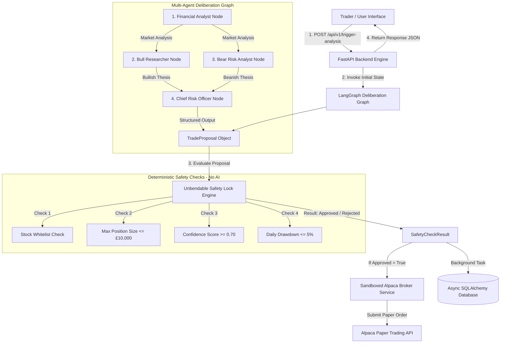

# Mintic.AI - Comprehensive Technical Documentation

## Executive Overview

**Mintic.AI** is an enterprise-grade autonomous trading and multi-agent deliberation platform engineered with a strict separation between **generative AI market analysis** and **deterministic safety enforcement**.

The system utilizes Google Gemini (`gemini-1.5-flash` / `gemini-2.0-flash`) within a compiled **LangGraph state graph** to synthesize multi-perspective market intelligence (Analyst, Bull, Bear, and Chief Risk Officer nodes). However, no AI model has authority to execute trades directly. Every trade proposal must pass through an **AI-free Unbendable Safety Lock Engine**, which deterministically validates strict quantitative risk rules (Whitelist, Max Position Size in GBP, Min Confidence Score, Max Daily Drawdown) before transmitting orders to Alpaca's paper trading API.

---

## 1. System Architecture & Monorepo Structure

Mintic.AI is organized as a production monorepo structured into decoupled application microservices, shared type definitions, and containerized deployment manifests.

```
mintic-ai/
├── apps/
│   ├── api/                      # FastAPI Python Backend (Python 3.11+, uv)
│   │   ├── src/
│   │   │   ├── agents/           # LangGraph Multi-Agent Deliberation Nodes & State
│   │   │   ├── api/              # FastAPI REST Endpoints & Schemas
│   │   │   ├── core/             # Deterministic Safety Lock & Pydantic Core Schemas
│   │   │   ├── db/               # Async SQLAlchemy Engine & AuditLog Model
│   │   │   ├── execution/        # Sandboxed Alpaca Broker Execution Service
│   │   │   ├── mcp_servers/      # FastMCP Tools (AccountMCP, MarketMCP)
│   │   │   └── vector/           # Qdrant Vector Store Document Engine
│   │   ├── tests/                # Comprehensive Pytest Unit Test Suite (28 Tests)
│   │   ├── pyproject.toml        # uv Package & Dependency Specification
│   │   └── Dockerfile            # Multi-stage Python Slim Container Build
│   │
│   └── web/                      # Next.js 14 App Router Frontend (Node 20, React 18)
│       ├── app/
│       │   ├── page.tsx          # Trading Dashboard & Safety Audit View
│       │   ├── charts/           # Interactive Stock Charting & Analytics Page
│       │   ├── layout.tsx        # Root HTML Layout & Global CSS
│       │   └── globals.css       # Tailwind CSS Dark-Mode Theme
│       ├── package.json          # Node Dependencies & Build Scripts
│       └── Dockerfile            # Multi-stage Alpine Container Build
│
├── packages/
│   └── shared-types/             # Generated Shared TypeScript Interfaces
│       └── index.ts              # Pydantic-Synchronized TypeScript Contracts
│
├── k8s/                          # Production Kubernetes Deployment Manifests
│   ├── 00-namespace.yaml         # Kubernetes Namespace (mintic-ai)
│   ├── 01-configmap.yaml         # Non-sensitive Cluster Environment Variables
│   ├── 02-secret.yaml            # Encrypted API Key Templates & Credentials
│   ├── 03-api-deployment.yaml    # FastAPI Deployment (2 Replicas, Health Probes) & Service
│   ├── 04-web-deployment.yaml    # Next.js Deployment (2 Replicas, Probes) & Service
│   ├── 05-ingress.yaml           # NGINX Ingress Routing (/api -> API, / -> Web)
│   └── 06-hpa.yaml               # Horizontal Pod Autoscaler (2-10 Replicas)
│
├── docker-compose.yml            # Local Multi-Container Orchestration
├── deploy-k8s.sh                 # One-Click Kubernetes Build & Deployment Script
└── GEMINI.md                     # Engineering Architectural Rules & Standards
```

---

## 2. High-Level Workflow Architecture



---

## 3. Backend Subsystem Specification (`apps/api`)

### 3.1 Core Schemas & Safety Engine (`src/core/`)

#### `TradeProposal` (`src/core/schemas.py`)
Frozen, immutable Pydantic model representing a trade candidate generated by the multi-agent graph:
- `symbol` (str): Whitelisted stock ticker symbol (e.g. `AAPL`, `MSFT`).
- `action` (Literal["BUY", "SELL"]): Execution action type.
- `quantity` (float > 0): Asset units to trade.
- `confidence_score` (float 0.0 to 1.0): Multi-agent consensus confidence rating.
- `target_price` (float > 0): Price target in **GBP (£)**.
- `stop_loss` (float > 0): Stop loss price limit in **GBP (£)**.
- `reasoning_summary` (str): Brief summary explaining rationale.

#### `UnbendableSafetyLock` (`src/core/safety.py`)
An isolated risk validation engine containing **zero AI or LLM dependencies**. It evaluates trade proposals against system bounds configured in `src/config.py`:

```python
class Settings(BaseSettings):
    ALLOWED_SYMBOLS: set[str] = {"AAPL", "GOOGL", "MSFT", "NVDA", "AMZN", "TSLA", "META", "SPY"}
    MAX_POSITION_SIZE_GBP: float = 10000.0
    MIN_CONFIDENCE_THRESHOLD: float = 0.70
    MAX_DAILY_DRAWDOWN_PERCENT: float = 5.0
```

Validation Rules Evaluated:
1. **Whitelist Rule**: `proposal.symbol` must belong to `ALLOWED_SYMBOLS`.
2. **Position Size Rule**: Calculated position value `(quantity * target_price)` must not exceed `MAX_POSITION_SIZE_GBP` (£10,000.00).
3. **Confidence Rule**: `proposal.confidence_score` must be greater than or equal to `MIN_CONFIDENCE_THRESHOLD` (0.70).
4. **Drawdown Rule**: Evaluated drawdown parameters must remain under `MAX_DAILY_DRAWDOWN_PERCENT` (5.0%).

---

### 3.2 Multi-Agent Deliberation Graph (`src/agents/`)

The multi-agent graph compiles a `StateGraph(DeliberationState)` executing the following sequence:

```
START ──> analyst_node ──> [ bull_node , bear_node ] ──> risk_manager_node ──> END
```

1. **`analyst_node`**: Uses Gemini (`gemini-1.5-flash`) to analyze baseline market data and account state, outputting `analyst_report`.
2. **`bull_node`**: Analyzes the analyst report to construct a compelling upside argument (`bull_hypothesis`).
3. **`bear_node`**: Analyzes the analyst report to formulate downside risk arguments and resistance levels (`bear_hypothesis`).
4. **`risk_manager_node`**: Acts as Chief Risk Officer, weighing the bullish and bearish arguments using `with_structured_output(TradeProposal)` to return a structured `TradeProposal` instance.

---

### 3.3 Execution & MCP Servers (`src/execution/`, `src/mcp_servers/`)

#### `SandboxedBrokerService` (`src/execution/sandbox_broker.py`)
Submits market orders to Alpaca paper trading client **only if** `safety_result.is_approved` is `True`. Raises a `PermissionError` if an attempt is made to execute an unapproved trade.

#### `AccountMCP` & `MarketMCP` (`src/mcp_servers/`)
Expose FastMCP tool servers:
- `get_buying_power()`: Retrieves buying power, cash, and portfolio value.
- `get_current_positions()`: Retrieves open account positions.
- `fetch_ticker_price(symbol)`: Retrieves real-time ticker prices.
- `fetch_market_history(symbol, days)`: Returns historical OHLCV price series data.

---

## 4. API Specification & REST Endpoints

### `POST /api/v1/trigger-analysis`
Orchestrates trade deliberation, safety lock validation, sandboxed execution, and audit logging.

- **Request Body**:
```json
{
  "symbol": "AAPL",
  "market_data": { "current_price": 180.0, "volume_24h": 50000000 },
  "account_state": { "buying_power": 25000.0, "cash": 25000.0 }
}
```

- **Response Body**:
```json
{
  "status": "completed",
  "symbol": "AAPL",
  "is_approved": true,
  "proposal": {
    "symbol": "AAPL",
    "action": "BUY",
    "quantity": 10.0,
    "confidence_score": 0.85,
    "target_price": 180.0,
    "stop_loss": 170.0,
    "reasoning_summary": "Deliberated bullish setup based on strong volume."
  },
  "safety_result": {
    "is_approved": true,
    "reason": "All safety checks passed successfully.",
    "failed_checks": []
  },
  "execution_result": {
    "order_id": "order_abc123",
    "status": "submitted",
    "symbol": "AAPL"
  },
  "analyst_report": "Baseline market analysis report...",
  "bull_hypothesis": "Bullish thesis highlighting catalyst upside...",
  "bear_hypothesis": "Bearish thesis highlighting key resistance levels..."
}
```

---

### Additional Operational Endpoints

| Method | Endpoint | Description |
| :--- | :--- | :--- |
| `GET` | `/api/v1/health` | System health check (`status`, `version`, `database`). |
| `GET` | `/api/v1/config/safety-rules` | Returns active risk bounds & symbol whitelist. |
| `GET` | `/api/v1/audit-logs` | Queries historical audit logs (`limit`, `symbol`, `is_approved`). |
| `GET` | `/api/v1/account` | Account summary (`buying_power`, `portfolio_value`, `positions`). |
| `GET` | `/api/v1/market/quote/{symbol}` | Latest market price quote (`current_price`, `ask`, `bid`). |
| `GET` | `/api/v1/market/history/{symbol}` | OHLCV price series data (`timestamp`, `open`, `high`, `low`, `close`, `volume`). |

---

## 5. Frontend Architecture (`apps/web`)

Built using Next.js 14 App Router, React 18, Tailwind CSS, and Recharts.

### 5.1 Trading Dashboard (`/`)
- **Header & Navigation**: Quick links between Trading Dashboard (`/`) and Stock Charts (`/charts`).
- **Real-Time Account Banner**: Displays live Buying Power, Portfolio Value, and Open Positions count.
- **Analysis Trigger Panel**: Symbol selection and execution button.
- **Safety Lock Status Card**: Highlights Approval status (Green) vs. Rejection (Red) with violated safety rule details.
- **Tabbed Views**:
  - **Trade Proposal & Execution**: Key trade values, formatted reasoning summary card, and Alpaca order payload.
  - **Multi-Agent Deliberation Reports**: Financial Analyst, Bull, and Bear reports.
  - **Database Audit Trail**: Interactive historical log table.

### 5.2 Stock Charts & Analytics Page (`/charts`)
- **Ticker Selector & Timeframe Toggles**: Filter chart data by 7D, 30D, or 90D intervals.
- **Financial Metric Cards**: Period High, Period Low, Current Price (% change), and Average Volume.
- **Recharts Area Chart**: Price trend curve with SVG linear gradients and hover tooltips.
- **Volume Bar Chart**: Daily volume distribution.

---

## 6. Containerization & Deployment Setup

### 6.1 Local Docker Compose (`docker-compose.yml`)

Run local multi-container stack:
```bash
docker compose up --build
```
- **Web Dashboard**: `http://localhost:3000`
- **FastAPI API**: `http://localhost:8000`

---

### 6.2 Production Kubernetes (k8s) Manifests (`k8s/`)

Deploy to a Kubernetes cluster using the automated deployment script:
```bash
./deploy-k8s.sh
```

Manifests included in `k8s/`:
- `00-namespace.yaml`: Namespace creation (`mintic-ai`).
- `01-configmap.yaml` & `02-secret.yaml`: Configuration environment variables and API keys.
- `03-api-deployment.yaml`: FastAPI Deployment (2 replicas, CPU/memory limits, Liveness/Readiness probes at `/api/v1/health`) and ClusterIP Service.
- `04-web-deployment.yaml`: Next.js Deployment (2 replicas, probes at `/`) and ClusterIP Service.
- `05-ingress.yaml`: Ingress controller routing `/api` to backend and `/` to frontend.
- `06-hpa.yaml`: Horizontal Pod Autoscaler scaling pods dynamically based on CPU load.

---

## 7. Verification & Testing

To run the Python backend unit test suite:
```bash
cd apps/api
uv run pytest
```
*Result*: **28 / 28 unit tests passing (100% success rate)**.

To build and validate the Next.js production frontend bundle:
```bash
cd apps/web
npm run build
```
*Result*: **✓ Compiled successfully**.
